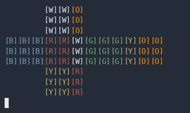

# Rubik's Cube Solver / Solveur de Rubik's Cube

---
### Preview
<div align="center">
  
</div>

## English

### Description
A Rubik's cube solver written in C. The program shuffles a cube, displays it in the terminal, and animates the solution step-by-step.

### Features
- Cube initialization and display in terminal
- Random shuffle
- Layer-by-layer solver
- Step-by-step animation between each move

### How the solver works
The cube is solved with **white on the UP face**. Centers: FRONT = red, RIGHT = green, BACK = orange, LEFT = blue.

#### 1. White cross (`strategy.c`)
`ft_solver` calls `ft_solve_white_cross` in a loop until `ft_white_cross` returns true (the 4 white edges on UP, each matching its side center). Each iteration does two things:
1. **`ft_to_down`** — finds one white edge that is not solved and plays a single move to bring it to the DOWN face, white sticker facing down:
   - edge in the middle layer → one turn of the adjacent face (e.g. white on `FRONT[1][0]` → `L`);
   - edge on the top layer with white facing sideways → turn that face (`F`, `R`, `B`, `L'`) to send it into the middle layer;
   - edge on the bottom layer with white facing sideways → turn that face to flip it, or `D` if the slot above is already solved;
   - white edge on UP but badly placed → double turn (`F2`, `R2`…) to send it down.
2. **`ft_align_down`** — if a white edge is on DOWN, reads its second color, turns `D` until the edge is under the matching center, then does a double turn of that face (`F2`, `R2`, `B2` or `L2`) to bring it up into place.

#### 2. White corners (`corner.c` → `corner4.c`)
`ft_find_corner` returns the position (slot) of a given corner: `0` UFR, `1` UFL, `2` UBL, `3` UBR, `4` DFR, `5` DFL, `6` DBL, `7` DBR.
Each corner is solved with the same 3-step method:
1. If the corner is stuck in **another** top slot, `ft_corner_to_down` kicks it out to the bottom layer (`X D X'`: down, step aside, put the cross edge back).
2. Turn `D` until the corner is right **under its target slot**.
3. Repeat the "sexy move" for that slot until the corner is solved (max 6 times).

| Corner | Colors | Target | Bottom slot | Repeated algorithm | File |
|---|---|---|---|---|---|
| 1 | white-red-green | UFR | DFR | `R' D' R D` | `corner.c` |
| 2 | white-red-blue | UFL | DFL | `L D L' D'` | `corner2.c` |
| 3 | white-orange-green | UBR | DBR | `B' D' B D` | `corner3.c` |
| 4 | white-orange-blue | UBL | DBL | `L' D' L D` | `corner4.c` |

The algorithm only touches its own slot and the bottom layer, so the cross and the corners already placed stay solved.

#### 3. Middle edges (`edge.c` → `edge3.c`)
`ft_place_edge1` → `ft_place_edge4` place the 4 middle-layer edges (red-green, red-blue, orange-green, orange-blue). An edge stuck in the wrong middle slot is first ejected to the bottom layer, then `D` is turned until it sits under its matching center and it is inserted with `D' R' D R D F D' F'` (to the right) or `D L D' L' D' F' D F` (to the left).

#### 4. Yellow cross (`cross.c`)
`ft_yellow_cross` orients the 4 DOWN edges so that `DOWN[0][1]`, `DOWN[1][0]`, `DOWN[1][2]` and `DOWN[2][1]` are yellow (their position relative to the centers is not fixed yet). It uses `F L D L' D' F'`, the yellow-down version of `F R U R' U' F'`:

| Case | Setup | Result |
|---|---|---|
| Dot (0 yellow edge) | none | L |
| L (2 adjacent) | `D` until yellow on `DOWN[1][2]` + `DOWN[2][1]` | line |
| Line (2 opposite) | `D` until yellow on `DOWN[1][0]` + `DOWN[1][2]` | cross |

The algorithm does not touch the first two layers.

#### 5. Yellow edges (`edge_y.c`)
`ft_place_yellow_edges` aligns the second color of each yellow edge with its center (`DOWN[0][1]` with FRONT, `DOWN[1][2]` with RIGHT, `DOWN[2][1]` with BACK, `DOWN[1][0]` with LEFT). It first turns `D` to the position that aligns the most edges (2 or 4, never 1 or 3), then uses `L D L' D L D2 L' D`, the yellow-down version of `R U R' U R U2 R' U`, which swaps the front and right edges of DOWN:

| Case | Action |
|---|---|
| 4 aligned | done |
| 2 adjacent aligned | apply on the two misaligned edges → 4 aligned |
| 2 opposite aligned | apply once, realign `D` → adjacent case |

The first two layers and the yellow cross stay solved.

#### 6. Yellow corners (`corner_y.c`)
`ft_place_yellow_corners` puts each yellow corner in the slot matching its 3 colors (yellow + the two adjacent centers), orientation ignored. It uses `D' R' D L D' R D L'`, the yellow-down version of `U R U' L' U R' U' L`, a 3-cycle of corners that keeps the front-right corner in place:

| Case | Action |
|---|---|
| 4 placed | done |
| 1 placed | turn the reference so it is the front-right corner, apply → 4 placed (or repeat once) |
| 0 placed | apply once → 1 placed case |

The first two layers, the yellow cross and the yellow edges stay solved.

#### 7. Yellow corners orientation (`corner_y2.c`)
`ft_orient_yellow_corners` twists each yellow corner in place. With the corner on the front-right slot of DOWN, it repeats `R U R' U'` until the yellow sticker is on `DOWN`, then turns `D` to bring the next corner. The rest of the cube looks scrambled in between, which is expected. After 4 corners, `D` is turned until the layers are aligned: the cube is solved.

### Requirements
- GCC
- Make

### Installation
```
git clone https://github.com/nicolasbgt-cell/Rubiks_Cube.git
cd Rubiks_Cube
make
./rubiks
```

### Project Structure
```
Rubiks_Cube/
├── assets/         # Demo GIF and other media
├── cube.h          # Defines, colors, t_cube struct
├── cube_init.c     # Cube initialization
├── display.c       # Terminal display
├── move.c          # Face rotations
├── shuffle.c       # Random scramble
├── strategy.c      # White cross
├── corner.c        # Corner search + 1st white corner (UFR)
├── corner2.c       # 2nd white corner (UFL)
├── corner3.c       # 3rd white corner (UBR)
├── corner4.c       # 4th white corner (UBL)
├── edge.c          # Middle edge search and checks
├── edge2.c         # Relative moves and edge insertion
├── edge3.c         # 4 middle edges placement
├── cross.c         # Yellow cross
├── edge_y.c        # Yellow edges alignment
├── corner_y.c      # Yellow corners placement
├── corner_y2.c     # Yellow corners orientation
├── solver.c        # Solver entry point / orchestration
├── main.c          # Entry point
├── Makefile
└── README.md
```

### Author
Nicolas Bigot — École 42 Paris

### Support
https://ko-fi.com/nicolasbgt

---

## Français

### Preview
<div align="center">
  
</div>

### Description
Un solveur de Rubik's cube écrit en C. Le programme mélange un cube, l'affiche dans le terminal et anime la résolution étape par étape.

### Fonctionnalités
- Initialisation et affichage du cube dans le terminal
- Mélange aléatoire
- Résolution couche par couche
- Animation étape par étape

### Fonctionnement du solveur
Le cube est résolu avec **le blanc sur la face UP**. Centres : FRONT = rouge, RIGHT = vert, BACK = orange, LEFT = bleu.

#### 1. Croix blanche (`strategy.c`)
`ft_solver` appelle `ft_solve_white_cross` en boucle jusqu'à ce que `ft_white_cross` renvoie vrai (les 4 arêtes blanches sur UP, chacune alignée avec le centre de sa face). Chaque tour de boucle fait deux choses :
1. **`ft_to_down`** — cherche une arête blanche pas encore placée et joue un seul mouvement pour l'amener sur la face DOWN, blanc vers le bas :
   - arête dans la couronne du milieu → un quart de tour de la face voisine (ex. blanc en `FRONT[1][0]` → `L`) ;
   - arête en haut avec le blanc sur le côté → on tourne cette face (`F`, `R`, `B`, `L'`) pour l'envoyer au milieu ;
   - arête en bas avec le blanc sur le côté → on tourne cette face pour la retourner, ou `D` si la case du dessus est déjà bonne ;
   - arête blanche sur UP mais mal placée → double tour (`F2`, `R2`…) pour la redescendre.
2. **`ft_align_down`** — si une arête blanche est sur DOWN, on lit sa deuxième couleur, on tourne `D` jusqu'à la placer sous le bon centre, puis on fait un double tour de cette face (`F2`, `R2`, `B2` ou `L2`) pour la remonter à sa place.

#### 2. Coins blancs (`corner.c` → `corner4.c`)
`ft_find_corner` renvoie la position (slot) d'un coin : `0` UFR, `1` UFL, `2` UBL, `3` UBR, `4` DFR, `5` DFL, `6` DBL, `7` DBR.
Chaque coin est résolu avec la même méthode en 3 étapes :
1. Si le coin est coincé dans **un autre** emplacement du haut, `ft_corner_to_down` le fait descendre (`X D X'` : on descend, on l'écarte, on remonte l'arête de la croix).
2. On tourne `D` jusqu'à ce que le coin soit **juste sous sa cible**.
3. On répète le « sexy move » de cet emplacement jusqu'à ce que le coin soit bon (6 fois max).

| Coin | Couleurs | Cible | Slot du bas | Algo répété | Fichier |
|---|---|---|---|---|---|
| 1 | blanc-rouge-vert | UFR | DFR | `R' D' R D` | `corner.c` |
| 2 | blanc-rouge-bleu | UFL | DFL | `L D L' D'` | `corner2.c` |
| 3 | blanc-orange-vert | UBR | DBR | `B' D' B D` | `corner3.c` |
| 4 | blanc-orange-bleu | UBL | DBL | `L' D' L D` | `corner4.c` |

L'algo ne touche que son emplacement et la couche du bas, donc la croix et les coins déjà placés restent résolus.

#### 3. Arêtes du milieu (`edge.c` → `edge3.c`)
`ft_place_edge1` → `ft_place_edge4` placent les 4 arêtes de la couronne du milieu (rouge-vert, rouge-bleu, orange-vert, orange-bleu). Une arête coincée dans un mauvais emplacement du milieu est d'abord éjectée vers le bas, puis on tourne `D` jusqu'à la placer sous le bon centre et on l'insère avec `D' R' D R D F D' F'` (vers la droite) ou `D L D' L' D' F' D F` (vers la gauche).

#### 4. Croix jaune (`cross.c`)
`ft_yellow_cross` oriente les 4 arêtes de DOWN pour que `DOWN[0][1]`, `DOWN[1][0]`, `DOWN[1][2]` et `DOWN[2][1]` soient jaunes (leur position par rapport aux centres n'est pas encore corrigée). Algo utilisé : `F L D L' D' F'`, version jaune en bas de `F R U R' U' F'` :

| Cas | Préparation | Résultat |
|---|---|---|
| Point (0 arête jaune) | aucune | L |
| L (2 voisines) | `D` jusqu'au jaune en `DOWN[1][2]` + `DOWN[2][1]` | ligne |
| Ligne (2 opposées) | `D` jusqu'au jaune en `DOWN[1][0]` + `DOWN[1][2]` | croix |

L'algo ne touche pas aux deux premières couronnes.

#### 5. Arêtes jaunes (`edge_y.c`)
`ft_place_yellow_edges` aligne la deuxième couleur de chaque arête jaune avec son centre (`DOWN[0][1]` avec FRONT, `DOWN[1][2]` avec RIGHT, `DOWN[2][1]` avec BACK, `DOWN[1][0]` avec LEFT). On tourne d'abord `D` jusqu'à la position qui aligne le plus d'arêtes (2 ou 4, jamais 1 ou 3), puis on utilise `L D L' D L D2 L' D`, version jaune en bas de `R U R' U R U2 R' U`, qui échange les arêtes avant et droite de DOWN :

| Cas | Action |
|---|---|
| 4 alignées | fini |
| 2 alignées voisines | algo sur les deux arêtes mal placées → 4 alignées |
| 2 alignées opposées | algo une fois, on réaligne `D` → cas voisin |

Les deux premières couronnes et la croix jaune restent résolues.

#### 6. Coins jaunes (`corner_y.c`)
`ft_place_yellow_corners` place chaque coin jaune dans l'emplacement correspondant à ses 3 couleurs (jaune + les deux centres adjacents), sans tenir compte de l'orientation. On utilise `D' R' D L D' R D L'`, version jaune en bas de `U R U' L' U R' U' L`, un 3-cycle de coins qui laisse le coin avant-droite en place :

| Cas | Action |
|---|---|
| 4 placés | fini |
| 1 placé | on tourne la référence pour qu'il soit le coin avant-droite, algo → 4 placés (ou on répète une fois) |
| 0 placé | algo une fois → cas 1 placé |

Les deux premières couronnes, la croix jaune et les arêtes jaunes restent résolues.

#### 7. Orientation des coins jaunes (`corner_y2.c`)
`ft_orient_yellow_corners` oriente chaque coin jaune sur place. Avec le coin sur l'emplacement avant-droite de DOWN, on répète `R U R' U'` jusqu'à ce que le jaune soit sur `DOWN`, puis on tourne `D` pour amener le coin suivant. Le reste du cube paraît mélangé entre-temps, c'est normal. Après les 4 coins, on tourne `D` jusqu'à aligner les couches : le cube est résolu.

### Prérequis
- GCC
- Make

### Installation
```
git clone https://github.com/nicolasbgt-cell/Rubiks_Cube.git
cd Rubiks_Cube
make
./rubiks
```

### Structure du projet
```
Rubiks_Cube/
├── assets/         # GIF de démo et autres médias
├── cube.h          # Defines, couleurs, struct t_cube
├── cube_init.c     # Initialisation du cube
├── display.c       # Affichage terminal
├── move.c          # Rotations des faces
├── shuffle.c       # Mélange aléatoire
├── strategy.c      # Croix blanche
├── corner.c        # Recherche de coin + 1er coin blanc (UFR)
├── corner2.c       # 2e coin blanc (UFL)
├── corner3.c       # 3e coin blanc (UBR)
├── corner4.c       # 4e coin blanc (UBL)
├── edge.c          # Recherche et vérification des arêtes du milieu
├── edge2.c         # Mouvements relatifs et insertion d'arête
├── edge3.c         # Placement des 4 arêtes du milieu
├── cross.c         # Croix jaune
├── edge_y.c        # Alignement des arêtes jaunes
├── solver.c        # Point d'entrée / orchestration du solveur
├── main.c          # Point d'entrée
├── Makefile
└── README.md
```

### Auteur
Nicolas Bigot — École 42 Paris

### Soutenir le projet
https://ko-fi.com/nicolasbgt